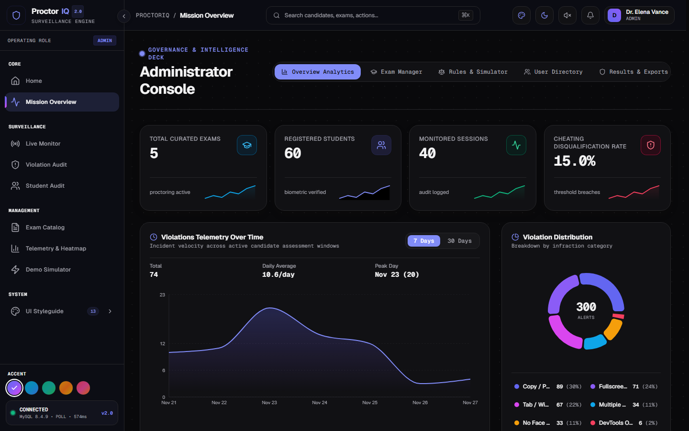
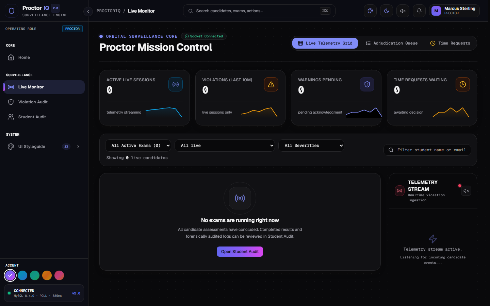
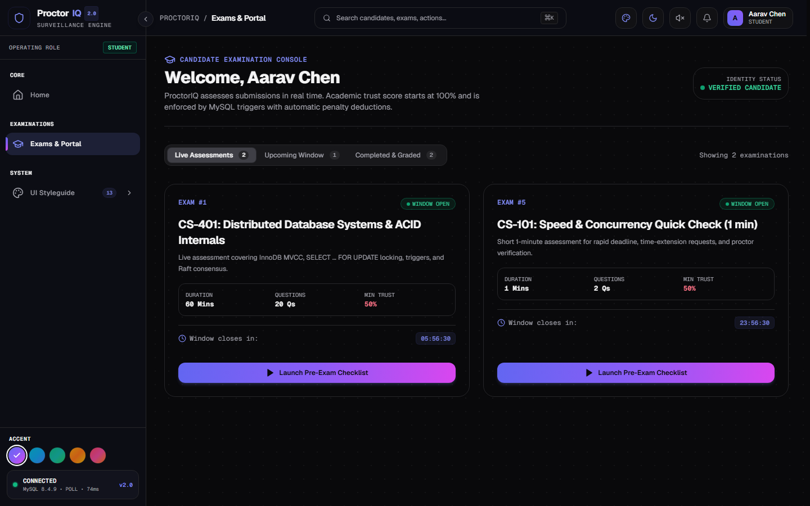

# 🛡️ ProctorIQ

<div align="center">

## 🎓 Online Exam Monitoring & Anti-Cheating System

### Real-Time Exam Proctoring with Database-Enforced Integrity

A modern web platform with three roles (Admin, Proctor, Student) where penalties, terminations and grading are enforced inside MySQL.


</div>

---

## 📖 Overview

ProctorIQ is a real-time exam proctoring platform with three roles: **Admin**, **Proctor** and **Student**.

Penalties, terminations and grading are enforced **inside MySQL** with triggers, stored procedures and transactions, so results stay correct even if violations arrive from several sources at once.

---

## ✨ Features

| Feature | Description |
| --- | --- |
| 🧮 **Trust Score Engine** | Students start at 100. A database trigger deducts points per violation and auto-terminates the exam below the minimum score |
| 👁️ **AI Detection** | Face, multiple faces, phone and speech detection, all running in the browser |
| ⚠️ **Warning System** | One penalty, one full-screen warning, then detection resumes after the student confirms |
| 🔀 **Unique Papers** | Questions and options are shuffled per student, and the answer key never leaves the server |
| ⏱️ **Extra Time Requests** | Students request extra minutes and the proctor approves, edits or rejects in real time |
| 📡 **Live Monitor** | Shows only students currently taking an exam, updated in real time |
| 🎥 **Exam Recording** | Webcam video stored for staff review in a full player (seek, 2x speed, fullscreen) |
| 🗂️ **Student Audit** | Each candidate's progress, average trust, scorecards and recordings |
| 🎨 **Themes** | Dark and cream-light themes with selectable accent colors |

---

## 👥 Roles

| Role | Can do |
| --- | --- |
| **Admin** | Manage exams, questions, penalty rules and users. View analytics, recordings and student audit |
| **Proctor** | Monitor live exams, review violations (Confirm / Dismiss), handle time requests, terminate sessions |
| **Student** | Take exams, see warnings, request extra time, view results |

---

## ⚖️ Violation & Penalty Rules

Penalties are **not fixed**. The admin can change the points for every violation type from the **Rules & Simulator** tab in the Admin Console, and the change applies to the next violation with no code changes. They are stored in the `Violation_Types` table.

| Violation | Detection |
| --- | --- |
| Tab switch / minimize | Browser visibility event |
| Fullscreen exit | Fullscreen event |
| Copy / cut / paste | Clipboard events |
| No face in frame | Face detection |
| Multiple faces | 2 or more faces for 5 continuous seconds |
| Phone detected | Object detection |
| Speech detected | Sustained speech on the microphone |
| DevTools opened | Window size and timing check |

If the trust score drops below the exam's minimum, the exam is terminated and the student is disqualified. A proctor can **Dismiss** a false alarm and the points are restored automatically.

---

## 🛠️ Tech Stack

| Layer | Technology |
| --- | --- |
| **Database** | MySQL 8.0+ (triggers, stored procedures, views) |
| **Backend** | Node.js, Express, TypeScript, Zod, JWT, bcrypt |
| **Frontend** | React, Vite, TypeScript, Tailwind CSS, Framer Motion, Recharts |
| **AI (in-browser)** | MediaPipe, Web Audio API |
| **Testing** | Vitest/Jest, Playwright |

---

## 📂 Project Structure

```bash
Online-Exam-Monitoring-System/
│
├── api/
│   └── index.ts              # Vercel serverless adapter
├── client/                   # React + Vite frontend
│   └── src/
│       └── pages/
│           └── LoginPage.tsx
├── server/                   # Express + TypeScript backend
│   └── src/
│       └── config/
│           └── env.ts
├── db/
│   ├── schema.sql            # Core tables, triggers, stored procedures
│   ├── seed.sql              # Penalty rules, demo accounts, sample exams
│   └── migrations/           # Incremental migrations
│
├── .env.example
├── vercel.json
├── package.json
└── README.md
```

---

## ⚡ Quick Start

### 1. Prerequisites

Ensure your system meets the following runtime and tooling requirements:

| Requirement | Supported Version | Verification Command | Notes |
| --- | --- | --- | --- |
| **Node.js** | `>= 20.6.0` | `node -v` | Required for native `process.loadEnvFile()` and `--env-file` support |
| **MySQL** | `>= 8.0` (8.0 or 8.4 LTS) | `mysql --version` | Needs triggers, stored procedures, and views support |
| **npm** | `>= 9.0.0` | `npm -v` | Installed with Node.js (`package-lock.json` lockfile) |
| **Browser** | Chromium (Chrome, Edge `>= 110`) | About > Version | Webcam & mic permissions required for MediaPipe and audio detection |

> [!NOTE]
> Students must grant camera and microphone access. Browsers only permit media devices on `localhost` or secure HTTPS origins.

---

### 2. Install & Configure MySQL

ProctorIQ requires a running MySQL 8.0+ server instance.

#### Windows

1. Download and run the **MySQL Community Server (or MySQL Installer)** from [MySQL Downloads](https://dev.mysql.com/downloads/installer/).
2. Install MySQL as a Windows Service (the default service name is **`MySQL80`** or **`MySQL84`**).
3. Verify that the service is running via Windows Services (`services.msc`) or PowerShell:

   ```powershell
   Get-Service -Name MySQL*
   ```

4. If stopped, start it via `net start MySQL84` or `net start MySQL80`.

#### macOS & Linux

- **macOS (Homebrew)**:

  ```bash
  brew install mysql && brew services start mysql
  ```

- **Linux (Ubuntu/Debian)**:

  ```bash
  sudo apt update && sudo apt install -y mysql-server && sudo systemctl start mysql
  ```

#### Grant Permissions to a Dedicated User (Optional)

If you prefer not to use `root`, create a dedicated user and grant privileges for both development and testing databases:

```sql
CREATE USER 'proctoriq_user'@'localhost' IDENTIFIED BY 'your_mysql_password';
GRANT ALL PRIVILEGES ON proctoriq.* TO 'proctoriq_user'@'localhost';
GRANT ALL PRIVILEGES ON exam_monitoring_test.* TO 'proctoriq_user'@'localhost';
FLUSH PRIVILEGES;
```

> [!TIP]
> If MySQL binary logging is active and trigger creation fails with error `1418`, execute:
> `SET GLOBAL log_bin_trust_function_creators = 1;` in your MySQL console.

---

### 3. Clone & Install Dependencies

> [!IMPORTANT]
> This repository is organized as a monorepo with distinct packages for the root runner, backend server, and frontend client. You must install dependencies across all three directories.

```bash
# Clone repository
git clone https://github.com/LR7Sujan/Online-Exam-Monitoring-System.git
cd Online-Exam-Monitoring-System

# Install root, server, and client dependencies
npm install && npm --prefix server install && npm --prefix client install
```

---

### 4. Configure Environment Variables

Create your local `.env` configuration file from the provided example template:

```bash
# Linux / macOS
cp .env.example .env

# Windows (Command Prompt)
copy .env.example .env

# Windows (PowerShell)
Copy-Item .env.example .env
```

#### Core Local Development Variables

Update `.env` with your local database credentials and a secure JWT secret:

```env
# Server Runtime
PORT=4000
NODE_ENV=development

# MySQL Database Connection
DB_HOST=127.0.0.1
DB_PORT=3306
DB_USER=root
DB_PASSWORD=your_mysql_password
DB_NAME=proctoriq

# Authentication
JWT_SECRET=replace_with_a_secure_random_secret_key

# Service Providers (local defaults require zero external APIs)
REALTIME_PROVIDER=polling
STORAGE_PROVIDER=local
RECORDING_RETENTION_DAYS=30
```

#### Client-Exposed Variables (Vite)

Variables prefixed with `VITE_` are bundled into the client browser application:

- `VITE_API_URL=/api`: Base path for API requests (proxied to `http://localhost:4000` by Vite in dev mode).
- `VITE_BACKEND_ORIGIN=http://localhost:4000`: Backend origin used to load static recordings and media assets.

#### Generate a Secure `JWT_SECRET` and `OTP_PEPPER`

You can generate cryptographically secure 256-bit random keys using Node.js:

```bash
# JWT Secret
node -e "console.log(require('crypto').randomBytes(32).toString('hex'))"

# OTP Pepper
node -e "console.log(require('crypto').randomBytes(32).toString('hex'))"
```

#### Email Setup (OTP Password Reset)

ProctorIQ supports three email delivery modes configured via `MAIL_PROVIDER`:

1. **Console Mode (`MAIL_PROVIDER=console`)** *(Default in Development)*:
   - Does not send real emails or require external credentials.
   - Prints the 6-digit verification code directly to the API server terminal:
     ```text
     ============================================================
     [DEV ONLY - OTP: 482917]
     To: student@proctoriq.io
     Subject: ProctorIQ: Your Verification Code
     Code (spaced): 4 8 2 9 1 7
     Expires: 10 minutes
     ============================================================
     ```
   - *Security Guard*: Automatically forbidden if `NODE_ENV=production`.

2. **SMTP Mode (`MAIL_PROVIDER=smtp`)** *(Production & Live Email)*:
   - Dispatches responsive HTML and plaintext emails using `nodemailer`.
   - Compatible with Google Workspace / Gmail, Brevo, SendGrid, Amazon SES, or custom SMTP servers.
   - **Gmail App Password Setup Steps**:
     1. Go to your Google Account Security settings (`myaccount.google.com/security`).
     2. Ensure **2-Step Verification** is enabled.
     3. Search for or navigate to **App passwords**.
     4. Create a new app password named `ProctorIQ`.
     5. Copy the 16-character passcode and paste it into `.env` as `SMTP_PASS`.
     6. Configure `.env`:
        ```env
        MAIL_PROVIDER=smtp
        MAIL_FROM="ProctorIQ Security <your_email@gmail.com>"
        SMTP_HOST=smtp.gmail.com
        SMTP_PORT=587
        SMTP_SECURE=false
        SMTP_USER=your_email@gmail.com
        SMTP_PASS=your_16_character_app_password
        ```

3. **Mock Mode (`MAIL_PROVIDER=mock`)** *(Automated Testing)*:
   - Used by the automated test suite to capture outgoing messages in memory without network calls.

| Variable | Description | Default |
| --- | --- | --- |
| `MAIL_PROVIDER` | Provider mode: `console`, `smtp`, or `mock` | `console` (`mock` in tests) |
| `MAIL_FROM` | Sender display name and email address | `"ProctorIQ Security <no-reply@proctoriq.io>"` |
| `APP_BASE_URL` | Root URL of frontend client for emails | `http://localhost:5173` |
| `SMTP_HOST` | Hostname of SMTP server (required for `smtp`) | None |
| `SMTP_PORT` | Port of SMTP server (`587` for TLS, `465` for SSL) | `587` |
| `SMTP_USER` | SMTP authentication username / email | None |
| `SMTP_PASS` | SMTP authentication password / app password | None |
| `SMTP_SECURE` | Set `true` for port 465, `false` for port 587/STARTTLS | `false` |
| `OTP_PEPPER` | Server secret pepper (min 32 chars) for HMAC hashing | Default dev pepper |


---

### 5. Initialize the Database

Run the automated migration and seed scripts in the following order:

```bash
# 1. Apply base schema, triggers, procedures, views, and incremental migrations
npm run db:migrate

# 2. Seed penalty rule definitions, demo accounts, and sample exams
npm run db:seed
```

#### What Each Command Creates

1. `npm run db:migrate`:
   - Creates the `proctoriq` database if it does not already exist.
   - Executes `db/schema.sql` (core tables: `Users`, `Exams`, `Questions`, `Exam_Sessions`, `Violations`, `Audit_Log`, triggers, stored procedures).
   - Sequentially applies all 17 migrations from `db/migrations/` (indexes, views, session tokens, audit security, foreign key cascades).
2. `npm run db:seed`:
   - Populates `Violation_Types` with configurable penalties and thresholds.
   - Creates demo accounts (Admin, Proctor, Student).
   - Sets up initial sample exams with question banks and shuffled options.

---

### 6. Start the Development Servers

Start both the backend Express API and the Vite frontend simultaneously:

```bash
npm run dev
```

#### Processes and Ports

- **Frontend Client**: Vite dev server runs on **<http://localhost:5173>**.
- **Backend API**: Express server with `tsx watch` runs on **<http://localhost:4000>**.
- **Proxy**: Vite automatically proxies `/api` and `/uploads` requests from port 5173 to port 4000.

#### Expected Terminal Output

When the servers are ready, you will see output similar to:

```text
[server] Server listening on port 4000 (polling fallback)
[server] Database connected: proctoriq
[client]   VITE v6.4.1  ready in 420 ms
[client]   ➜  Local:   http://localhost:5173/
[client]   ➜  Network: use --host to expose
```

---

## 🔑 Demo Accounts

Open **<http://localhost:5173>** in Google Chrome or Microsoft Edge.

| Role | Email | Password | Landing Page |
| --- | --- | --- | --- |
| **Admin** | `admin@proctoriq.io` | *add here* | `/admin` (Analytics, Exam Management, Rules, Simulator) |
| **Proctor** | `proctor@proctoriq.io` | *add here* | `/proctor` (Live Candidate Monitor, Violation Review) |
| **Student** | `student@proctoriq.io` | *add here* | `/student` (Student Exam Portal & Past Scorecards) |

> [!NOTE]
> Demo passwords are encrypted with bcrypt in `db/seed.sql`. For rapid local testing, one-click demo login buttons are provided directly on the Login page (`client/src/pages/LoginPage.tsx`), where the default local seed password is defined.
>
> ⚠️ **Security Warning**: Always change default demo passwords and configure a unique `JWT_SECRET` prior to deploying to any shared or production environment.

---

## ✅ Verify the Installation

Confirm everything is functioning correctly by checking these three items:

1. **API Health Endpoint**:
   Visit <http://localhost:4000/api/health> in your browser or run:

   ```bash
   curl http://localhost:4000/api/health
   ```

   Expected response:

   ```json
   {"success":true,"data":{"api":"up","db":"up","status":"ok"}}
   ```

2. **Student Authentication**:
   Open <http://localhost:5173>, click **Student Demo** on the login page, and verify immediate redirect to the `/student` dashboard displaying assigned exams.
3. **Sidebar Connectivity Indicator**:
   Observe the bottom-left sidebar status indicator. It should show a green dot and **"Connected"**, confirming active heartbeat polling and WebSocket synchronization.

---

## 🧪 Running Tests

ProctorIQ features automated unit, integration, and end-to-end test suites.

```bash
# 1. Reset and initialize the isolated test database
npm run db:test:reset

# 2. Run backend & frontend unit and integration tests
npm test

# 3. Run Playwright end-to-end browser tests
npm run test:e2e
```

### Test Database Safety Isolation

- Automated test runs strictly target `exam_monitoring_test` on test API port `4001` and client port `5174`.
- The codebase enforces `assertTestDatabaseSafety()` in `server/src/config/env.ts`: any destructive test script or teardown operation is blocked immediately if `NODE_ENV !== 'test'` or the target database name does not end with `_test`.
- Your primary development database (`proctoriq`) is completely protected from test wipes.

---

## 🚢 Production Build & Deployment

### Compiling for Production

```bash
# Builds server to /server/dist and client to /client/dist
npm run build
```

### Running the Production Server

```bash
npm --prefix server start
```

The compiled Express production server serves the backend API and can serve the compiled client static assets directly from `client/dist`.

### Serverless Deployment (Vercel)

The project includes root `vercel.json` and `api/index.ts` adapters. When deploying to Vercel:

- Backend Express routes are mapped serverlessly via `@vercel/node`.
- Static frontend assets from `client/dist` are deployed to the Edge CDN.
- Configure all required variables from `.env.example` in your Vercel Project Settings.

---

## 🩺 Troubleshooting & Common Pitfalls

| Problem | Exact Error / Symptom | Root Cause | Solution |
| --- | --- | --- | --- |
| **MySQL Not Running** | `ECONNREFUSED 127.0.0.1:3306` | MySQL service is stopped or not listening on port 3306. | Windows: Start **`MySQL80`** or **`MySQL84`** in `services.msc` or run `net start MySQL84`.<br>macOS: `brew services start mysql`<br>Linux: `sudo systemctl start mysql` |
| **Invalid Database Credentials** | `ER_ACCESS_DENIED_ERROR: Access denied for user '...'@'...'` | `DB_USER` or `DB_PASSWORD` in `.env` is incorrect. | Update `DB_USER` and `DB_PASSWORD` in `.env` with correct MySQL credentials. Verify with `mysql -u <user> -p`. |
| **Missing Database** | `ER_BAD_DB_ERROR: Unknown database 'proctoriq'` | Migrations have not yet been executed. | Run `npm run db:migrate` followed by `npm run db:seed`. The migration script creates the database automatically if missing. |
| **Port Conflict** | `listen EADDRINUSE: address already in use :::4000` | Port `4000` or `5173` is occupied by another process. | Find and terminate the process:<br>**Windows**: `netstat -ano \| findstr :4000` then `taskkill /PID <PID> /F`<br>**macOS/Linux**: `lsof -i :4000` then `kill -9 <PID>` |
| **Missing `.env` File** | `TypeError: Cannot read properties of undefined` or missing DB config | `.env` was not created before starting the application. | Copy `.env.example` to `.env` (`copy .env.example .env`) and set your database password. |
| **Missing Dependencies** | `Error: Cannot find module '...'` | Node dependencies are missing in root, client, or server. | Re-run `npm install && npm --prefix server install && npm --prefix client install`. |
| **Trigger Creation Privilege** | `ER_BINLOG_CREATE_ROUTINE_NEED_SUPER` (Error 1418) | Binary logging is enabled and function/trigger creation requires superuser trust. | Log into MySQL as root/admin and run:<br>`SET GLOBAL log_bin_trust_function_creators = 1;` |
| **Camera / Mic Denied** | `NotAllowedError: Permission denied` | Browser blocked webcam/mic or page is not on `localhost`/HTTPS. | Click the permissions/tune icon next to the URL in Chrome/Edge, set Camera and Microphone to **Allow**, and refresh. |
| **Sidebar Disconnected** | Red **DISCONNECTED** badge in sidebar | Frontend cannot reach `http://localhost:4000/api/health`. | Ensure backend server is running (`npm run dev`) and MySQL database is connected. Check browser devtools Network tab. |

---

## 🔐 Security & Privacy

- Passwords hashed with bcrypt, JWT login with role checks on every route
- Scores, penalties, time and question order are decided on the server
- Violation audit log is protected by a database trigger and cannot be deleted
- Recordings are visible to Admin and Proctor only, every view is logged, and files are deleted after the retention period
- Audio is analyzed on the student's device and is **never recorded or uploaded**
- Students accept a consent notice before the camera and microphone are used

---

## ⚠️ Known Limitations

- Browser-based proctoring can be bypassed, so use a lockdown browser for high-stakes exams
- Phone and speech detection can misfire. Proctors can dismiss false alarms
- Recordings use disk space, so set the retention period to match your storage

---

## 📸 Screenshots

### Admin Console



### Live Proctor Monitor



### Student Exam Portal



---

## 👨‍💻 Author

- **Author**: Sujan L R
- **GitHub**: <https://github.com/LR7Sujan>
- **Contact**: <sujanlr77@gmail.com>

---

### 🛡️ Fair Exams Through Intelligent Monitoring

Built with React, Node.js, and MySQL 🎓

⭐ Star this repository if you found it useful.
