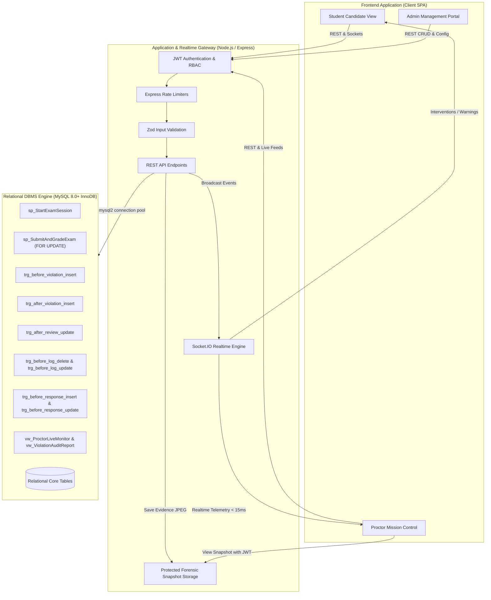
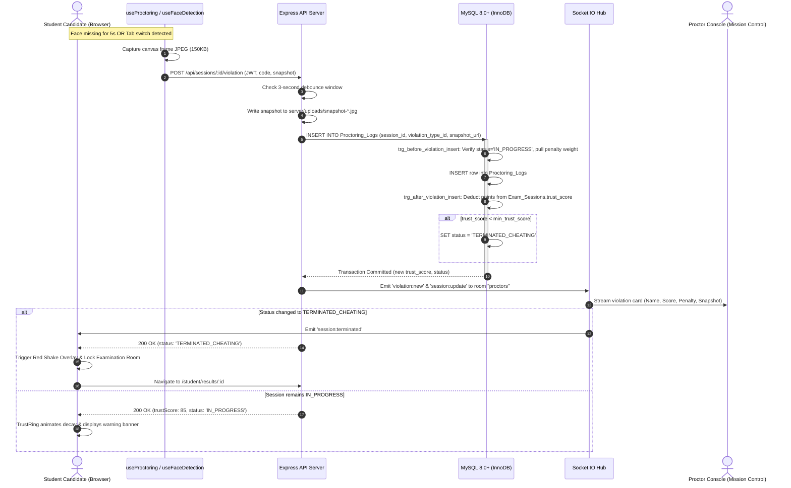
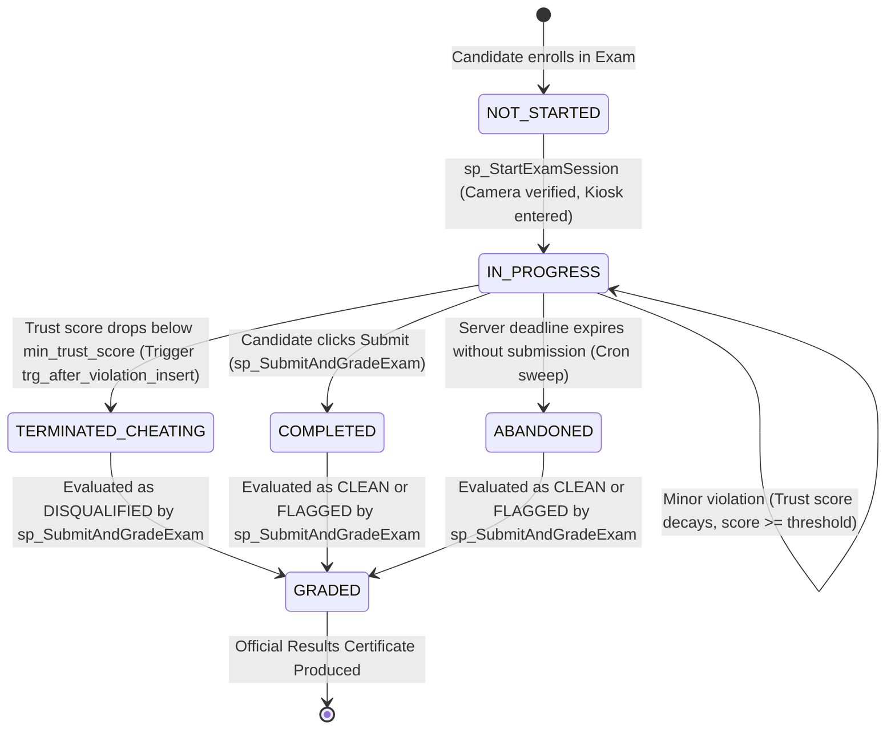
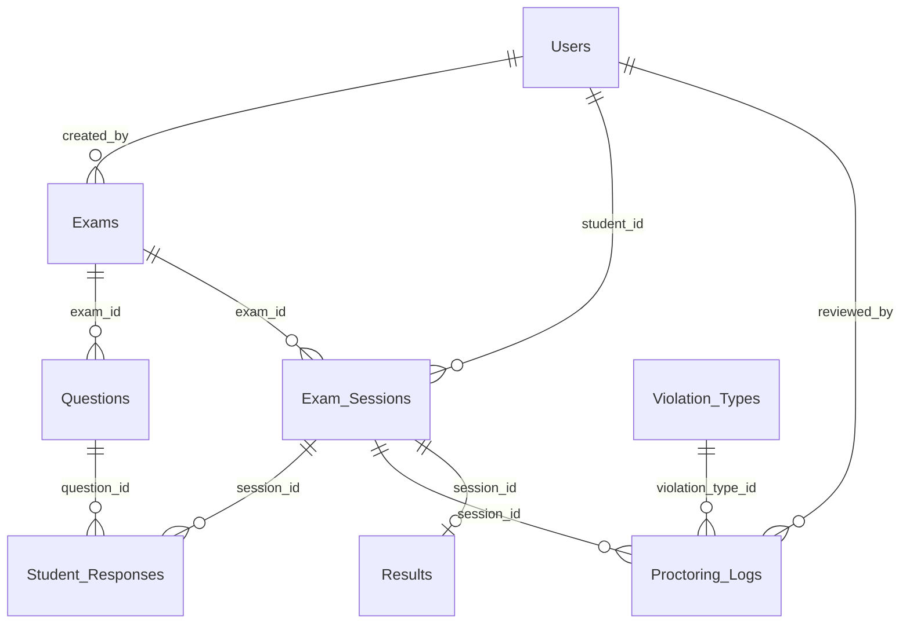

# ProctorIQ System Architecture & Forensic Engineering

ProctorIQ is an authoritative, **DBMS-centric Online Exam Monitoring and Academic Integrity Engine**. Business invariants, penalty accounting, trust score decay, automatic disqualification thresholds, server-clock deadlines, atomic answer autosaves, and concurrency-locked grading are executed inside **MySQL 8.0+** rather than volatile application memory.

---

## 1. High-Level System Architecture



---

## 2. Real-Time Telemetry & Event Sequence

The diagram below details the exact sequence when a candidate commits a violation during an active examination:



---

## 3. Exam Session Lifecycle & State Machine



---

## 4. Concurrency & Anti-Double-Grading Mechanism

A critical vulnerability in online examination platforms is the **double-submit race condition**: when a candidate manually clicks "Submit" at the exact moment their deadline expires and an automated background worker triggers auto-submission.

### Pessimistic Row Locking with `SELECT ... FOR UPDATE`

ProctorIQ solves this entirely inside stored procedure `sp_SubmitAndGradeExam`:

```sql
DELIMITER $$
CREATE PROCEDURE sp_SubmitAndGradeExam(
    IN p_session_id INT,
    OUT p_result_id INT
)
BEGIN
    DECLARE v_current_status VARCHAR(30);
    DECLARE v_exam_id INT;
    DECLARE v_trust_score DECIMAL(5,2);
    DECLARE v_min_trust DECIMAL(5,2);

    -- 1. Acquire exclusive write lock on this session row
    SELECT status, exam_id, trust_score
      INTO v_current_status, v_exam_id, v_trust_score
      FROM Exam_Sessions
     WHERE id = p_session_id
       FOR UPDATE;

    -- 2. Reject if already finalized by another thread
    IF v_current_status IN ('COMPLETED', 'ABANDONED') THEN
        SIGNAL SQLSTATE '45000'
           SET MESSAGE_TEXT = 'SESSION_ALREADY_GRADED: Exam session is already finalized.';
    END IF;

    -- 3. Calculate marks, determine integrity status, insert Results atomically
    ...
END$$
DELIMITER ;
```

#### Why this guarantees exactly one result:
1. When Thread A calls `sp_SubmitAndGradeExam`, `SELECT ... FOR UPDATE` acquires an exclusive row lock on `Exam_Sessions`.
2. Thread B attempting to call `sp_SubmitAndGradeExam` at the exact same millisecond is placed into a lock wait state by InnoDB.
3. Thread A executes grading, changes `status` to `COMPLETED`, inserts the row into `Results`, and commits the transaction.
4. When Thread B's lock wait resolves, it immediately reads `v_current_status = 'COMPLETED'`, triggers `SQLSTATE '45000'`, and exits cleanly without modifying data.

---

## 5. Relational Forensic Schema & Indexing Strategy



### Strategic Indexes for Low-Latency Query Execution

| Index | Table | Columns | Purpose |
| :--- | :--- | :--- | :--- |
| `uq_exam_student` | `Exam_Sessions` | `(exam_id, student_id)` | Enforces single active session per student; sub-millisecond lookup in `sp_StartExamSession`. |
| `idx_sessions_status_deadline` | `Exam_Sessions` | `(status, server_deadline)` | Accelerates server-side cron auto-close sweeps (`WHERE status = 'IN_PROGRESS' AND server_deadline < NOW()`). |
| `idx_logs_session_occurred` | `Proctoring_Logs` | `(session_id, occurred_at)` | Powers the proctor timeline chart and student audit history without scanning un-related logs. |
| `idx_logs_review_occurred` | `Proctoring_Logs` | `(proctor_review_status, occurred_at)` | Powers the Adjudication Queue (`WHERE proctor_review_status = 'PENDING' ORDER BY occurred_at DESC`). |
| `uq_session_question` | `Student_Responses` | `(session_id, question_id)` | Enables atomic UPSERTs on answer modification without creating duplicate answers. |

---

## 6. Client-Side Face Detection & Obscuration Pipeline

1. **Lightweight Optical Processing:** The client webcam stream is sampled approximately once per second on an offscreen HTML5 `<canvas>`.
2. **MediaPipe Face Detection Integration:** Utilizes MediaPipe BlazeFace (`@mediapipe/face_detection`) client-side with native fallback to `window.FaceDetector` and optical contrast analysis.
3. **5-Second Consecutive Rule:** If 0 faces are detected across 5 consecutive samples (5 seconds), the engine flags a `NO_FACE` violation.
4. **Multi-Candidate Detection:** If 2 or more faces are detected in a single frame, a `MULTIPLE_FACES` violation (-35 PTS) is triggered immediately.
5. **Snapshot Ingestion:** On each violation, a compressed JPEG snapshot is converted to base64, transmitted to `/api/sessions/:id/violation`, written to `server/uploads/snapshot-*.jpg`, and stored as `snapshot_url`.
6. **Authenticated Static Serving:** The static route `/uploads` is protected with JWT verification middleware (`Authorization: Bearer <token>` or `?token=<jwt>`), preventing unauthenticated public scraping of student photos.

---

## 7. Security Architecture & Threat Defense

- **Cryptographic Password Storage:** Passwords hashed with `bcrypt` (10 rounds of salt generation).
- **Dual JWT Token Lifecycle:**
  - Access Token: 15-minute / 1-hour expiry, signed with `HS256`.
  - Refresh Token: 7-day expiry with dedicated refresh route (`POST /api/auth/refresh`).
- **HTTP Header Hardening:** `helmet` enabled with custom Content Security Policy (CSP) and Cross-Origin Resource Policy (CORP).
- **Strict CORS Origin Isolation:** Express accepts requests only from authorized frontend origins (`http://localhost:5173`, `http://127.0.0.1:5173`).
- **Defense in Depth Rate Limiting:**
  - `authRateLimiter`: 100 requests / 15 minutes on `/login`, `/register`, `/refresh`.
  - `violationRateLimiter`: 120 requests / 1 minute on `/violation` reports.
- **Payload Sanitization & Obfuscation:** The student question endpoint (`GET /api/sessions/:id/questions`) explicitly removes `correct_option` and `explanation` from SQL results before transmitting payloads to candidate browsers.
