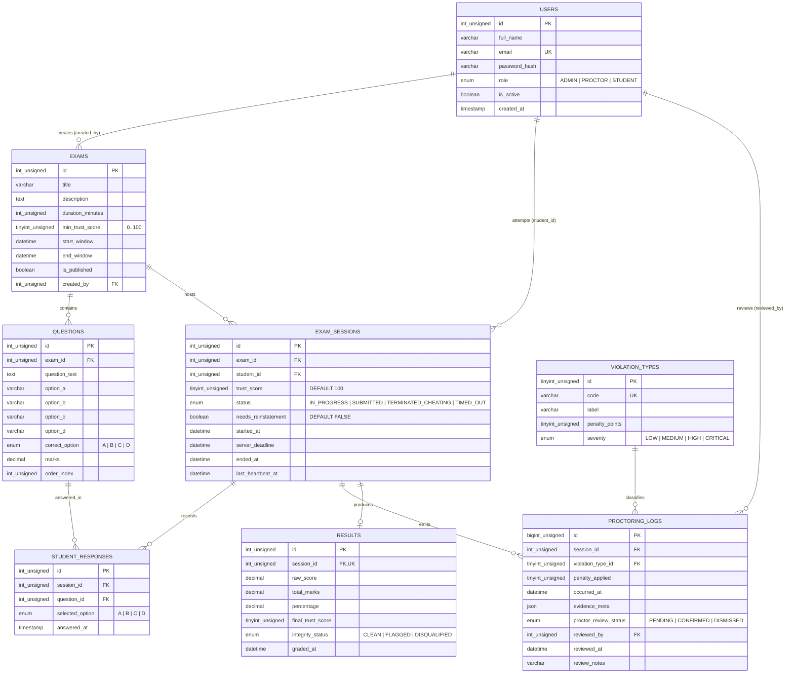

# ProctorIQ Database Entity-Relationship & Integrity Design

## 1. Entity-Relationship Diagram



---

## 2. Third Normal Form (3NF) Justification

1. **1NF (Atomic Values & Keys)**: Every table has an explicit `PRIMARY KEY`, atomic scalar columns (with `evidence_meta` storing unstructured sensor payload metadata cleanly as JSON), and no repeating groups (`Questions` are normalized out of `Exams`, and `Student_Responses` are normalized out of `Exam_Sessions`).
2. **2NF (No Partial Dependencies)**: All composite business keys—`UNIQUE(exam_id, student_id)` on `Exam_Sessions` and `UNIQUE(session_id, question_id)` on `Student_Responses`—are mapped to surrogate `id` PKs with every non-key attribute depending on the full entity key (e.g. `selected_option` depends on both `session_id` and `question_id`).
3. **3NF (No Transitive Dependencies)**:
   - Violation definitions (`code`, `label`, `penalty_points`, `severity`) are isolated in `Violation_Types` rather than duplicated inside `Proctoring_Logs`. (`penalty_applied` is intentionally snapshotted at insert time so historical penalties remain auditable if catalog weights ever change.)
   - Exam thresholds (`min_trust_score`, `duration_minutes`) live exclusively on `Exams`, not duplicated in `Exam_Sessions`.
   - User identities (`full_name`, `email`, `role`) live solely on `Users`, referenced by `student_id`, `created_by`, and `reviewed_by`.

---

## 3. Trigger Execution Flow

```text
INSERT INTO Proctoring_Logs (session_id, violation_type_id, ...)
  │
  ▼ [trg_before_violation_insert]
  ├─ Verify Exam_Sessions.status = 'IN_PROGRESS' (else SIGNAL 45000)
  └─ Lookup Violation_Types.penalty_points → lock NEW.penalty_applied
  │
  ▼ [trg_after_violation_insert]
  ├─ Compute new_trust = GREATEST(0, trust_score - NEW.penalty_applied)
  ├─ IF new_trust < Exams.min_trust_score:
  │     UPDATE Exam_Sessions SET trust_score = new_trust, status = 'TERMINATED_CHEATING', ended_at = NOW()
  └─ ELSE:
        UPDATE Exam_Sessions SET trust_score = new_trust

UPDATE Proctoring_Logs SET proctor_review_status = 'DISMISSED' ...
  │
  ▼ [trg_before_log_update]
  └─ Reject mutations to forensic columns (id, session_id, violation_type_id, penalty_applied, occurred_at, evidence_meta)
  │
  ▼ [trg_after_review_update]
  ├─ On PENDING/CONFIRMED → DISMISSED: add penalty_points back (capped at 100)
  └─ IF status = 'TERMINATED_CHEATING' AND old_trust < min_trust AND restored_trust >= min_trust:
        Set Exam_Sessions.needs_reinstatement = TRUE (never silently reopens exam)

DELETE FROM Proctoring_Logs
  │
  ▼ [trg_before_log_delete]
  └─ Always raises SIGNAL SQLSTATE '45000' (append-only audit immutability)
```

---

## 4. `SELECT ... FOR UPDATE` Locking Strategy

In `sp_SubmitAndGradeExam(p_session_id, p_trigger_source)` and `sp_StartExamSession(p_exam_id, p_student_id)`:
1. **Race-Condition Prevention**: If a student clicks Submit at the exact millisecond a heartbeat timeout or violation auto-termination runs, two concurrent transactions could attempt to grade the same session simultaneously and insert duplicate `Results` rows.
2. **Pessimistic Row Lock**: `sp_SubmitAndGradeExam` executes `START TRANSACTION` and immediately acquires an exclusive InnoDB row lock via:
   ```sql
   SELECT es.exam_id, es.trust_score, es.status, es.server_deadline, e.min_trust_score
     FROM Exam_Sessions es
     JOIN Exams e ON e.id = es.exam_id
    WHERE es.id = p_session_id
    FOR UPDATE;
   ```
3. **Deterministic Serialization & Idempotency**: The second concurrent caller blocks at `FOR UPDATE` until the first transaction commits. Once unblocked, the second caller checks `Results` (`FOR UPDATE`), sees the newly committed `Results` row, and returns it cleanly without double-grading or throwing a duplicate key error.

